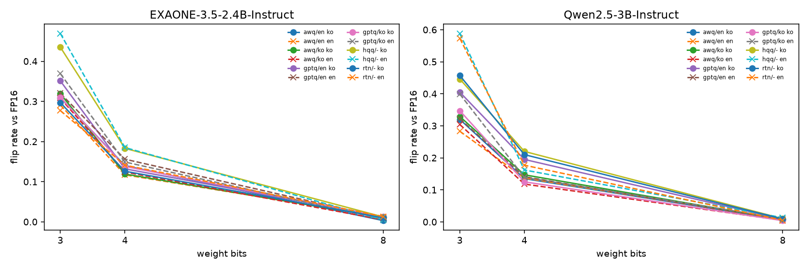

<div align="center">

# 🇰🇷 Does 4-bit Speak Korean?

**양자화는 한국어를 얼마나, 어디서, 왜 망가뜨리는가**


</div>

> LLM을 4비트 이하로 줄이면 비라틴 언어가 더 크게 망가진다는 보고(Marchisio et al. 2024)와, 그렇지 않다는 보고(arXiv 2503.03592)가 엇갈립니다. 이 저장소는 **같은 모델·같은 하네스**로 한국어와 영어를 나란히 측정해 이를 판정하고, 원인을 찾고, 줄이는 방법(한국어 특화 뉴런 보호)까지 가는 연구입니다.

## 📌 지금까지의 결과 (E1: 측정)

모델 2개(EXAONE-3.5-2.4B, Qwen2.5-3B) × 양자화 4종(RTN·HQQ·GPTQ·AWQ식) × {8, 4, 3}비트 × 보정 언어(영/한), 총 38개 설정. 한국어 KMMLU와 영어 MMLU 각 1,000문항, 한·영 위키 perplexity.

**1. 보정 언어가 한국어가 아니면, 한국어가 항상 더 망가진다.**
보정이 없거나 영어로 보정한 3·4비트 설정 **16개 중 16개**에서 한국어 perplexity 증가가 영어보다 컸습니다(로그 기준 중앙값 1.47배).

| 설정 (3비트) | EXAONE 한 / 영 PPL 증가 | Qwen 한 / 영 PPL 증가 |
|---|---|---|
| RTN | ×1.60 / ×1.57 | ×17,876 / ×654 (붕괴) |
| HQQ | ×4.02 / ×2.79 | ×119 / ×22.6 |
| GPTQ (영어 보정) | ×1.57 / ×1.29 | ×1.89 / ×1.36 |
| AWQ식 (영어 보정) | ×1.61 / ×1.46 | ×1.67 / ×1.40 |

**2. 한국어로 보정하면 세금이 사라지는데, 그 대가를 영어가 낸다 (GPTQ).**

| GPTQ 3비트 | EXAONE 한 / 영 | Qwen 한 / 영 |
|---|---|---|
| 영어 보정 | ×1.57 / ×1.29 | ×1.89 / ×1.36 |
| 한국어 보정 | ×1.43 / **×1.50** | ×1.36 / **×1.81** |

AWQ식은 보정 언어에 거의 둔감했습니다(EXAONE ×1.61 vs ×1.62). "GPTQ는 보정 언어에 민감하고 AWQ는 강건하다"는 [Calibrating Beyond English (EACL 2026)](https://arxiv.org/abs/2601.18306)의 관찰을 한국어에서 재현한 결과입니다.

**3. 객관식 정확도로는 이 차이가 거의 안 보인다.**
같은 설정들에서 flip rate(FP16 대비 정답이 뒤집힌 비율)가 한국어 쪽이 더 큰 경우는 24개 중 12개로 방향이 없었습니다. 한국어 FP16 정확도가 원래 낮아(EXAONE 40%, Qwen 43%, 우연 수준 25%) 정확도 지표가 손상을 가립니다. "자동 정확도 지표가 다국어 손상을 과소평가한다"는 Marchisio et al.의 지적과 같은 방향입니다.

<p align="center"></p>

전체 표: [results/e1_summary.md](results/e1_summary.md)

## 🧭 연구 질문

| | 질문 | 상태 |
|---|---|---|
| RQ1 | 같은 비트에서 한국어 손실이 영어보다 큰가? | ✅ E1 (위 결과) |
| RQ2 | 원인은 한국어 특화 뉴런·토큰 활성값인가? | ⏳ Plan 2 |
| RQ3 | 한국어 특화 뉴런을 FP16으로 보호하면 같은 비트에서 손실이 줄어드나? | ⏳ Plan 2 (핵심 기여) |
| RQ4 | 한국어는 토큰이 더 많아 KV 캐시 비용과 KV 양자화 손실도 더 큰가? 4GB/8GB 기기 추천 설정은? | ⏳ Plan 3 |

설계 문서: [docs/superpowers/specs/2026-11-14-korean-quant-tax-design.md](docs/superpowers/specs/2026-11-14-korean-quant-tax-design.md)

## 🛠 구조

```
kqt/quant.py      RTN, HQQ, GPTQ, AWQ식 그룹 양자화 (행렬 → 역양자화 행렬)
kqt/model.py      디코더 층 단위 적용, GPTQ·AWQ 보정 통계 수집
kqt/data.py       위키 해시 분할(탐지/보정/평가 서로소), KMMLU·MMLU 로더
kqt/evaluate.py   4지선다 로그우도 채점, flip rate, KL, perplexity
run.py            설정 목록 실행 → 설정별 JSON (재개 가능)
launch/           Kaggle T4 작업 제출·대기·회수
analysis/         한·영 비교표와 그래프
```

## 🚀 재현

```bash
pip install -r requirements.txt
python -m pytest                     # 36개, CPU만으로 동작
python launch/kaggle_job.py --slug kqt-e1-qwen -- --model Qwen/Qwen2.5-3B-Instruct --grid e1
python analysis/e1_summary.py
```

Kaggle 작업은 `transformers==5.1.0`으로 고정합니다(EXAONE 3.5 원격 코드 호환). E1은 코드 커밋 `409d7a9`, 모델 리비전 Qwen `aa8e725`, EXAONE `ccce25b`로 실행했습니다.

## ⚠️ 한계와 메모

- 정확도 실험은 **시뮬레이션 양자화**(양자화 후 역양자화)입니다. 실제 속도·메모리는 RQ4에서 실제 커널로 따로 잽니다.
- GPTQ는 층 내부 순차 보정(true-sequential)과 act_order를 쓰지 않았고, AWQ는 Linear마다 스케일을 따로 찾으며 clipping 탐색이 없는 **AWQ식** 변형입니다.
- KMMLU는 CC-BY-ND라 문항 원문은 저장하지 않고 점수만 커밋합니다.
- 한 설정당 1회 실행입니다. 핵심 셀은 RQ3에서 시드 3개로 반복합니다.

## 📚 참고

Marchisio et al. 2024 (arXiv 2407.03211) · arXiv 2503.03592 · Chimoto et al. 2026 (arXiv 2601.18306) · Waskito et al. 2026 (AACL Findings) · Tang et al. 2024, Language-Specific Neurons (arXiv 2402.16438) · Dutta et al. 2024, Accuracy is Not All You Need (arXiv 2407.09141) · GPTQ, AWQ, HQQ, SmoothQuant, KIVI
